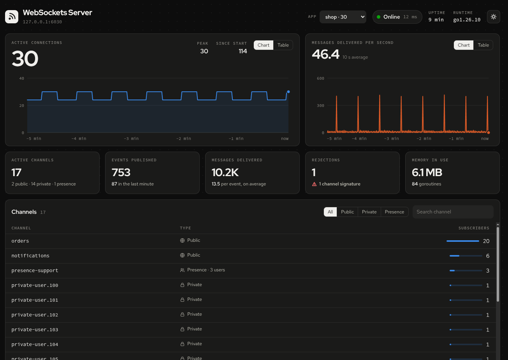
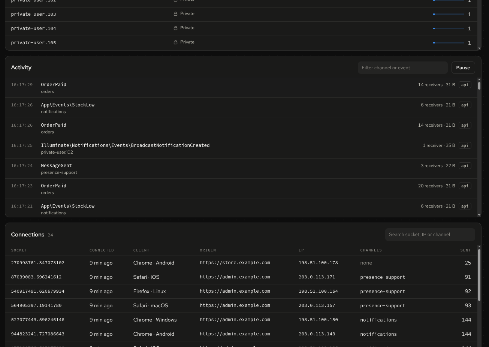

# WebSockets Server

A self-hosted WebSocket server that speaks the Pusher protocol, written in Go.

Point your backend's Pusher driver at it and your frontend keeps using `pusher-js` or Laravel
Echo unchanged. It is a single binary with no runtime dependencies, serves several applications
from one process and ships with a live status panel.



## Why

It started as a replacement for `laravel-websockets` on a multi-tenant Laravel platform, where
real-time features had never worked reliably: the WebSocket server managed its own TLS
certificate and broke on every renewal. This server takes the opposite approach:

- **No TLS to manage.** It listens on localhost and lets the web server you already have
  terminate TLS, so certificate renewals never touch it.
- **Nothing to install.** One static binary; copy it and run it.
- **Fails safe.** Events only notify; your data lives in your application. If the server is
  down, the app keeps working and browsers reconnect on their own when it comes back.

## Features

- Public, private and presence channels, with the standard channel authorization signatures.
- Client events (`whisper`) on private and presence channels.
- The Pusher HTTP API that server libraries publish with: `events`, `batch_events` and channel
  queries, with signature, timestamp and body verification.
- **Several applications in one process**, each with its own credentials, allowed origins,
  channels and statistics.
- Origin allow-list with subdomain wildcards (`https://*.example.com`).
- Real client address behind a local reverse proxy.
- Status panel: connections, channels, activity feed, rejected attempts, memory. It only
  answers requests from the machine it runs on.

Not implemented yet: encrypted channels, webhooks and user authentication (`pusher:signin`).

## Status panel

The panel is served by the binary itself and answers only requests made from the machine it
runs on. On a remote server, open it through an SSH tunnel:

```bash
ssh -L 6001:127.0.0.1:6001 your-server    # then open http://127.0.0.1:6001
```



## Quick start

```bash
go build -o websockets-server .
PUSHER_APP_ID=app PUSHER_APP_KEY=key PUSHER_APP_SECRET=secret ./websockets-server
```

Then open the panel at <http://127.0.0.1:6001>.

In a Laravel project you can read the credentials straight from its `.env`:

```bash
./websockets-server -env /path/to/laravel/.env
```

| Flag | Purpose | Default |
|---|---|---|
| `-addr` | Address to listen on | `127.0.0.1:6001` |
| `-env` | `.env` file with `PUSHER_APP_ID`, `PUSHER_APP_KEY` and `PUSHER_APP_SECRET` | environment variables |
| `-config` | JSON file with a list of apps (see below) | single app |
| `-origins` | Allowed browser origins, comma separated | all |
| `-cert`, `-key` | Serve TLS directly instead of sitting behind a proxy | no TLS |

### Several applications

```bash
./websockets-server -config apps.json
```

```json
{
  "apps": [
    { "id": "1001", "key": "shop-key", "secret": "…", "name": "shop", "origins": ["https://*.shop.example"] },
    { "id": "1002", "key": "blog-key", "secret": "…", "name": "blog" }
  ]
}
```

Applications are fully isolated: a channel named `orders` in one app is unrelated to `orders`
in another, and one app's secret cannot publish into another. The panel gets an app selector.

## Connecting your application

### Laravel

Use the regular `pusher` driver and point it at the server:

```php
// config/broadcasting.php
'pusher' => [
    'driver' => 'pusher',
    'key' => env('PUSHER_APP_KEY'),
    'secret' => env('PUSHER_APP_SECRET'),
    'app_id' => env('PUSHER_APP_ID'),
    'options' => [
        'host' => env('PUSHER_HOST', '127.0.0.1'),
        'port' => env('PUSHER_PORT', 6001),
        'scheme' => env('PUSHER_SCHEME', 'http'),
    ],
],
```

```js
// Laravel Echo
window.Echo = new Echo({
    broadcaster: 'pusher',
    key: import.meta.env.VITE_PUSHER_APP_KEY,
    cluster: 'mt1',
    wsHost: window.location.hostname,
    wssPort: 443,
    forceTLS: true,
    disableStats: true,
    enabledTransports: ['ws', 'wss'],
});
```

The key is baked into your JavaScript at build time. If the frontend is built in CI, the key
has to exist in that environment, not only in the server's `.env`.

### Any other backend

Anything that publishes with a Pusher server library works: set its host, port and scheme to
this server. Browsers use `pusher-js` with `wsHost` pointing at your domain.

### The reverse proxy

The browser connects to your own domain and the web server forwards `/app/` to this server.
`examples/` has ready-to-adapt snippets:

| File | For |
|---|---|
| `nginx.conf`, `apache.conf` | Forwarding `/app/` from your HTTPS site |
| `websockets-server.service` | Running it under systemd |
| `supervisor.ini` | Running it under Supervisor |
| `apps.json` | Serving several applications |

## How it works

```
Browser ── wss://your-domain/app/KEY ──► web server (TLS) ──► websockets-server (localhost)
                                                                     ▲
Backend ── signed POST /apps/ID/events ──────────────────────────────┘
```

1. The browser opens the WebSocket and asks to join its channels.
2. For a private or presence channel, the client library asks your backend for a signature
   (`/broadcasting/auth` in Laravel). The server verifies it with the application secret
   before accepting the subscription.
3. When the backend broadcasts an event, it sends a signed HTTP request. The server verifies
   the signature and fans the event out to the browsers subscribed to that channel.

Event payloads are never stored or logged; the panel shows only their size.

## Performance

Measured on a laptop with client and server on the same machine, using `cmd/loadtest`:

| Connections | Messages delivered | Time | Median delay |
|---|---|---|---|
| 1,000 | 20,000 | 82 ms | 5 ms |
| 10,000 | 200,000 | 918 ms | 44 ms |

The process idles at a few megabytes and stood at about 320 MB after the 10,000-connection
run. The optimized static binary is 7 MB. These are local figures: there is no network between
client and server, so real-world delays will be higher.

## Development

```bash
go test ./...                                    # signatures, multi-app isolation, presence, origins
go run ./cmd/loadtest -conns 1000 -events 20     # load test against a local server
npm install && npm run css                       # only needed to change the panel's styles
```

The signature tests use vectors generated with `pusher-php-server`, the library Laravel signs
with, so they check compatibility with a real backend rather than with the server itself.

The panel (`web/`) is embedded in the binary; rebuild after changing it. It is built with
Vue 2.7 and Tailwind CSS 4, with no build step for the JavaScript.

A static build for older Linux servers:

```bash
CGO_ENABLED=0 go build -trimpath -ldflags "-s -w" -o websockets-server .
```

## Compatibility

Tested with `pusher-js` 4.4, Laravel Echo 1.x and `pusher-php-server` 4.1 (Laravel 7 and 8).
Other versions and other languages' Pusher libraries should work, but have not been verified.

## License

[MIT](LICENSE). Bundled third-party files: Vue 2.7 (MIT) and the Red Hat and Source Code Pro
fonts (SIL Open Font License 1.1, see `web/lib/fonts/LICENSE.txt`).

## Author

**David Albarrán** · [@DavidAGB](https://github.com/DavidAGB)
